# Capítulo 2. Conjuntos de escape: Mandelbrot y Julia

::: resumen
**Resumen del capítulo.** Mandelbrot y Julia iteran $z^2 + c$ y colorean cada píxel según la rapidez con que escapa. El módulo 1 lo calcula en la GPU con WebGL; su límite es la precisión de 32 bits al ampliar.
:::

## 2.1 Descripción del algoritmo

Los conjuntos de escape se definen iterando la función cuadrática compleja:

$$z_{n+1} = z_n^{2} + c$$

- **Conjunto de Mandelbrot.** Se parte de $z_0 = 0$ y se prueba cada valor de *c* del plano complejo. Pertenece al conjunto el *c* para el cual la sucesión permanece acotada.
- **Conjunto de Julia.** Se fija un *c* y se prueba cada punto inicial $z_0$ del plano. Cada valor de *c* genera un conjunto distinto.

En la práctica no se puede iterar indefinidamente. Se fija un número máximo de iteraciones y se considera que un punto **escapa** cuando |z| supera un radio de escape: si |z| > 2, la sucesión diverge con seguridad. Los puntos que no escapan tras el máximo de iteraciones se pintan como pertenecientes al conjunto (negro en la aplicación). Los demás se colorean según la rapidez con que escapan.

### Coloreado suave

Colorear por el número entero de iteraciones produce bandas visibles. El módulo 1 aplica un coloreado suave que usa un valor continuo de iteración:

$$\mu = n + 1 - \log_2\!\left(\log_2 \lvert z\rvert\right)$$

Para que la aproximación sea precisa se usa un radio de escape grande (en el prototipo, |z|² > 256). El valor $\mu$ se pasa por una escala logarítmica y luego por una paleta cosenoidal.

### Implementación en la aplicación

El cálculo se hace en el *fragment shader* de WebGL: cada píxel evalúa su propia iteración en la GPU, lo que permite zoom y animación fluidos. Los controles son:

- Selector Mandelbrot / Julia, con deslizadores para la parte real e imaginaria de *c* y una lista de conjuntos famosos.
- Iteraciones máximas, de 30 a 1500.
- Cinco paletas de color y animación del color.
- Zoom y desplazamiento con el ratón, reinicio de la vista y exportación a PNG.
- **Construir desde cero** y **Órbita de un punto**, dos modos didácticos que explican cómo se forma cada imagen (siguiente apartado).

### Cómo se forma la imagen, paso a paso

La aplicación permite ver el conjunto **antes de que exista**. Con **Construir desde cero** se limita el número de iteraciones a *k*, que se aumenta de 0 a 60 con un control deslizante o con el botón de reproducción. En este modo el radio de escape es 2 y cada iteración en que un punto escapa se pinta de un color distinto, de modo que se ven **capas**. En la iteración 0 todo es negro, porque aún no se ha calculado nada. En la iteración 1 ya salen los puntos con $|c| > 2$. A medida que *k* crece, el negro que queda, formado por los puntos que todavía no han escapado, se acerca al conjunto de Mandelbrot (Figuras 2.8 a 2.11).

Con **Órbita de un punto** se elige un punto con el cursor y se dibuja la sucesión $z_0, z_1, z_2, \dots$ de ese punto sobre el plano, junto con la circunferencia $|z| = 2$ y los primeros valores numéricos. Si la órbita sale de la circunferencia y no vuelve, el punto **escapa** y no pertenece al conjunto (Figura 2.13). Si permanece cerca del origen, el punto **pertenece** al conjunto (Figura 2.12). Así se ve la definición del conjunto aplicada a un punto concreto.

Otros tres recursos completan la parte didáctica. La **Vista dividida** muestra, junto al plano de Mandelbrot, el conjunto de Julia del punto bajo el cursor: cada punto *c* de Mandelbrot es el parámetro de un conjunto de Julia distinto (Figura 2.14). El **Modo presentación** recorre ocho escenas, cada una con una frase explicativa, desde la pantalla en negro hasta el vínculo con Julia. **Grabar video** guarda ese recorrido como un archivo `.webm`, de modo que la propia aplicación genera el material multimedia.

## 2.2 Fortalezas

- **Paralelismo natural.** Cada píxel es independiente, por lo que el cálculo se ajusta bien a la GPU.
- **Detalle a cualquier escala.** El borde del conjunto muestra estructura nueva al ampliar.
- **Pocos parámetros, mucha variedad.** Cambiar *c* o el número de iteraciones modifica radicalmente la imagen.
- **Implementación breve.** El núcleo del algoritmo cabe en pocas líneas.

## 2.3 Debilidades

- **Precisión numérica.** El prototipo usa números de coma flotante de 32 bits (`float32`), por lo que el zoom profundo degrada la imagen y el módulo muestra una advertencia al llegar al límite. Superarlo exige aritmética de mayor precisión, con coste elevado.
- **Coste creciente con el zoom.** Cerca del borde hacen falta más iteraciones para distinguir puntos.
- **Decisión de pertenencia aproximada.** Un punto que no escapa en *N* iteraciones podría escapar más tarde.
- **Dependencia de WebGL.** Navegadores o equipos sin soporte no pueden ejecutar el módulo.

## 2.4 Caso práctico de aplicación

Los conjuntos de escape se emplean en **generación de texturas y arte procedural**, y como banco de pruebas de rendimiento de GPU, ya que son una carga computacional controlable. Un uso docente típico es explorar cómo la dinámica de una función simple, como `z² + c`, produce comportamientos regulares y caóticos. Un ejemplo concreto en la aplicación es el conjunto de Julia «Dragón» (`c = −0,8 + 0,156i`), que ilustra cómo un cambio pequeño de *c* altera por completo la forma.

## 2.5 Capturas y demostración

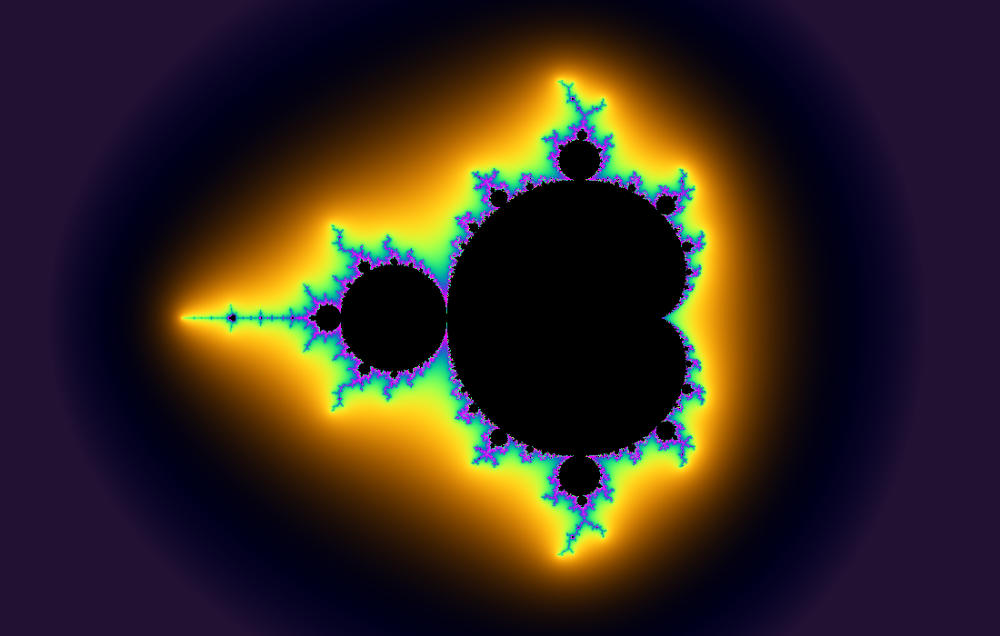{width=78% nota="Captura propia del módulo 1. 200 iteraciones máximas y paleta «Atardecer»."}

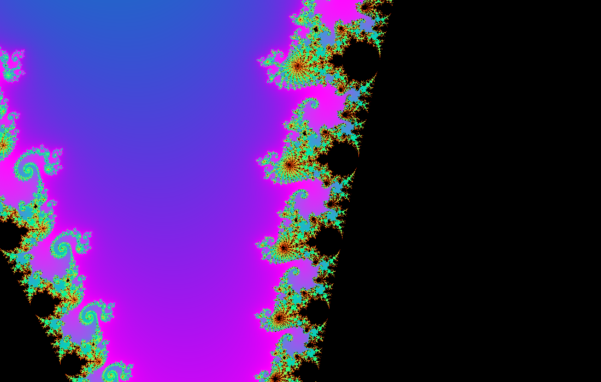{width=78% nota="Captura propia. Centro en −0,7436 + 0,1318*i*; 400 iteraciones. La estructura reaparece al ampliar."}

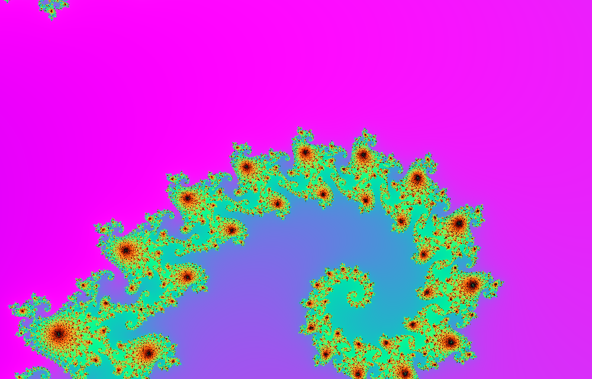{width=78% nota="Captura propia. Mismo centro; 900 iteraciones. Se aprecia la autosimilitud a distintas escalas."}

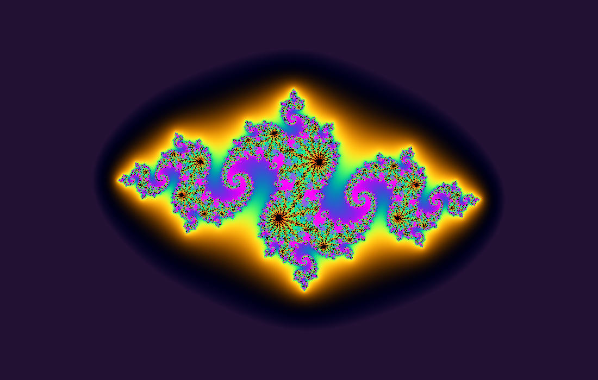{width=78% nota="Captura propia. *c* = −0,8 + 0,156*i*; 300 iteraciones."}

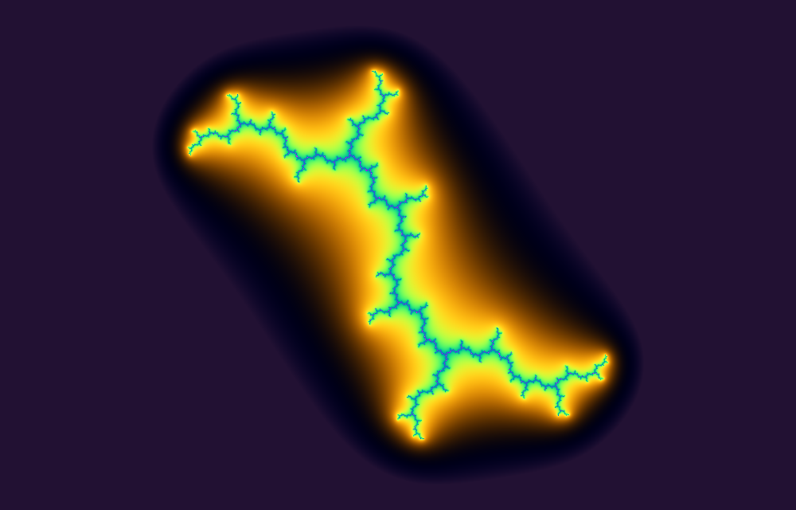{width=78% nota="Captura propia. *c* = *i*; 300 iteraciones. Un cambio en *c* altera por completo la forma."}

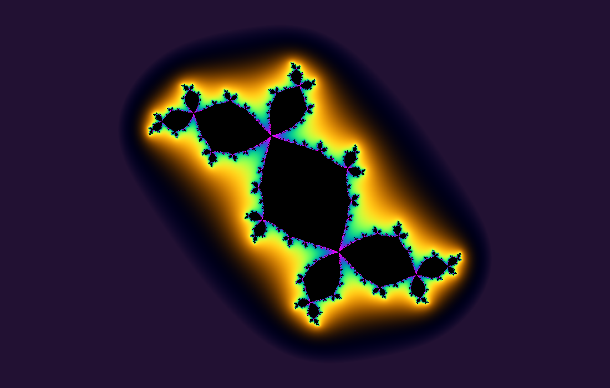{width=78% nota="Captura propia. *c* = −0,123 + 0,745*i*; 300 iteraciones."}

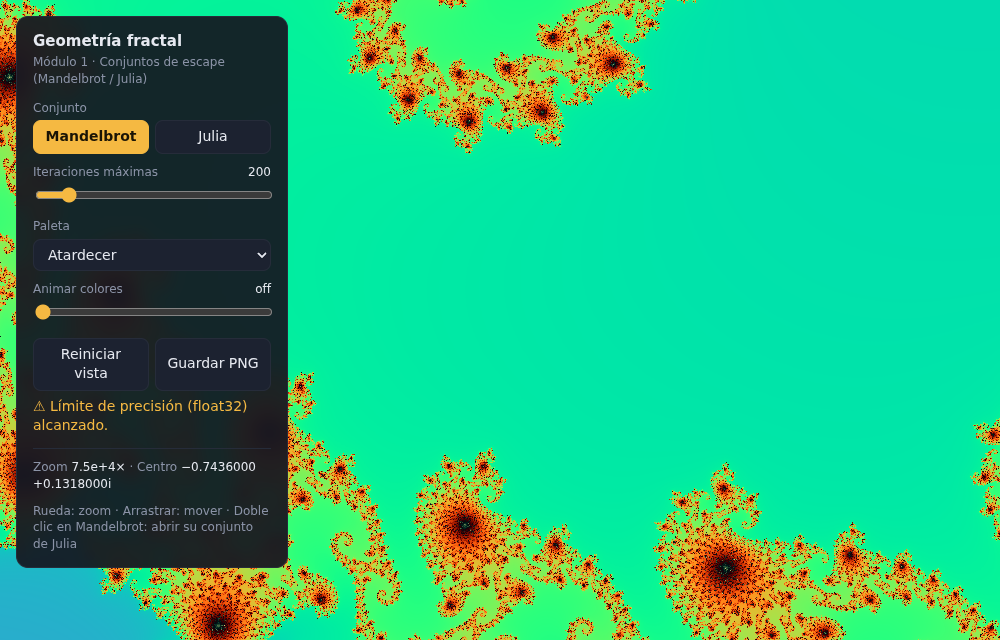{width=90% nota="Captura propia. Con un zoom de 7,5 × 10⁴ aparece la advertencia y la imagen se pixela (sección 2.3)."}

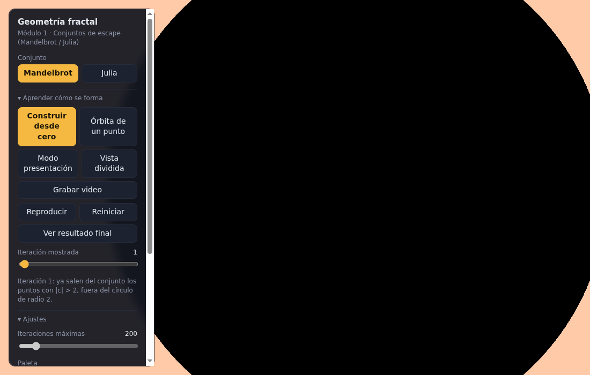{width=88% nota="Captura propia del módulo 1, modo «Construir desde cero». Solo han escapado los puntos con $|c| > 2$; el resto sigue en negro."}

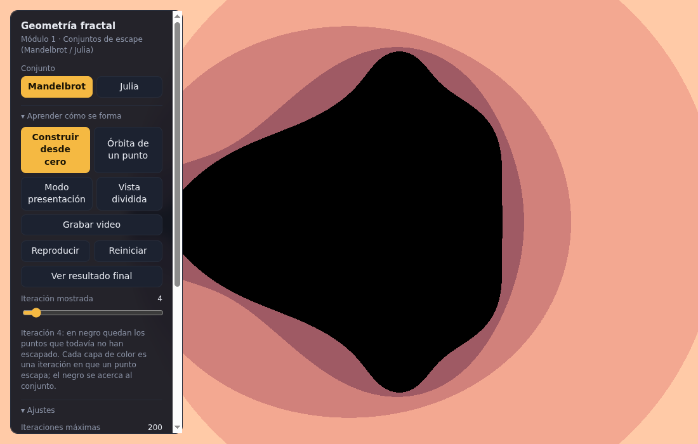{width=88% nota="Captura propia. Cada capa de color es una iteración en que un punto escapa. El negro aún tiene forma redondeada."}

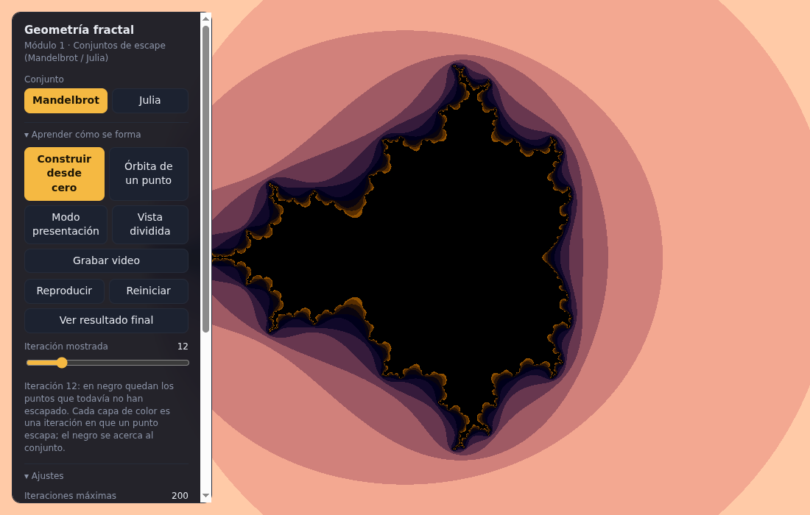{width=88% nota="Captura propia. Aparece la silueta del conjunto de Mandelbrot y el borde empieza a mostrar detalle."}

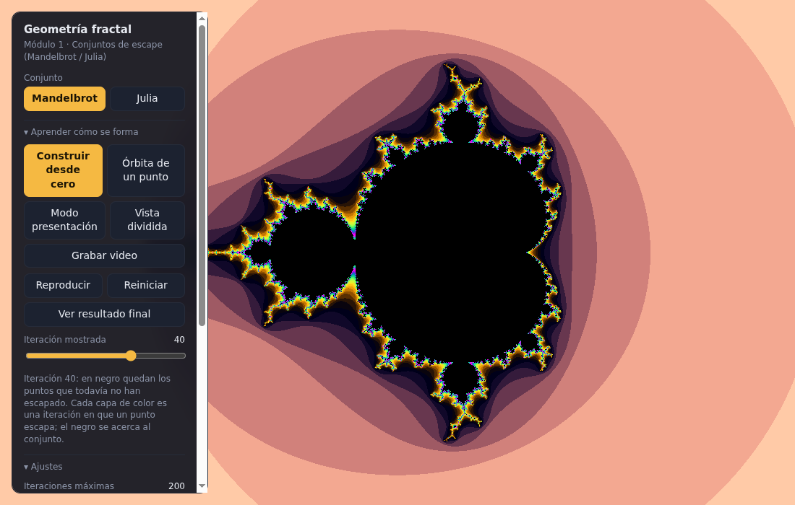{width=88% nota="Captura propia. El negro restante se ajusta al conjunto; más iteraciones solo afinan el borde."}

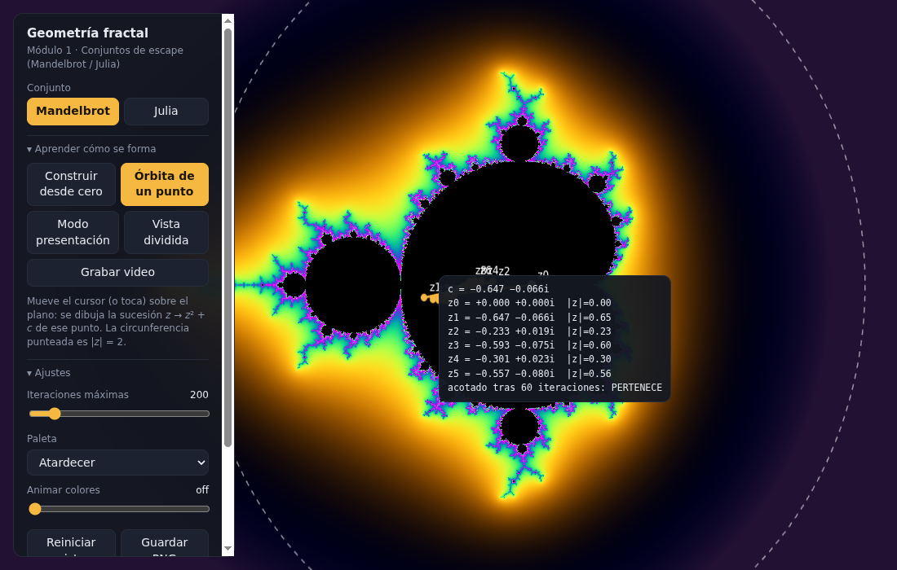{width=88% nota="Captura propia, modo «Órbita de un punto». La sucesión de $c = -0{,}06 + 0{,}03i$ se queda cerca del origen: el punto pertenece al conjunto."}

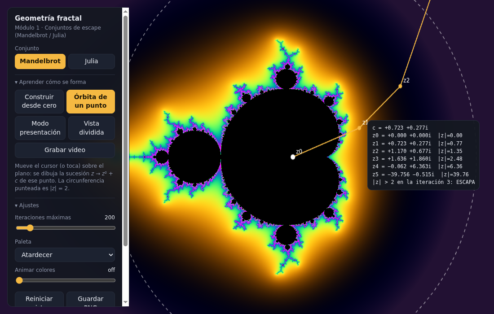{width=88% nota="Captura propia. Con $c = 0{,}723 + 0{,}277i$, la órbita sale de la circunferencia $|z| = 2$ en la iteración 3: el punto escapa."}

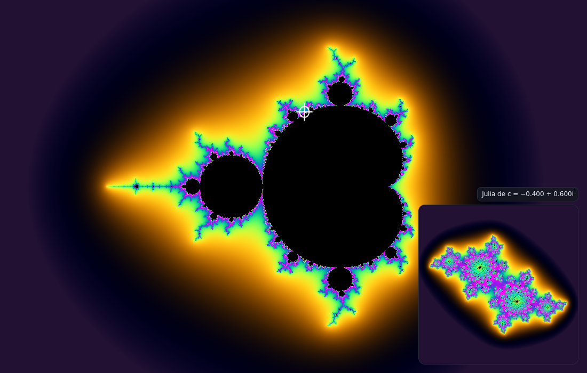{width=88% nota="Captura propia, modo «Vista dividida». El recuadro de la derecha es el conjunto de Julia de $c = -0{,}4 + 0{,}6i$, el punto marcado con la cruz en el plano de Mandelbrot."}

<strong>Pruébalo en la aplicación.</strong> Escanea el código o abre la dirección: https://pieersx.github.io/geometria-fractal/modulos/01-conjuntos-escape/

## 2.6 Referencias del capítulo

La autosimilitud estadística y la dimensión fraccionaria que subyacen a estos conjuntos se tratan en Mandelbrot (1967). La definición matemática de conjuntos autosimilares por iteración se formaliza en Hutchinson (1981).
