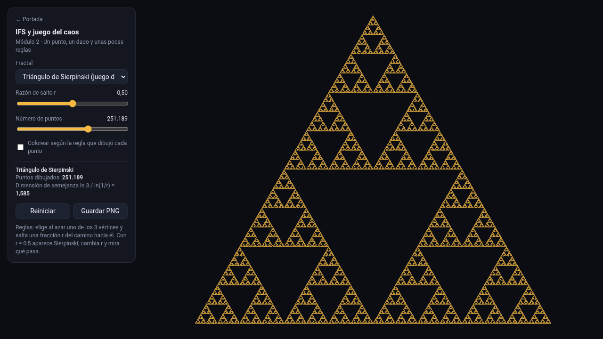
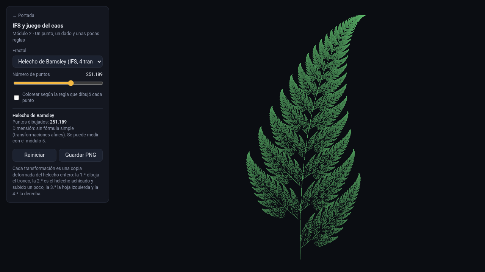
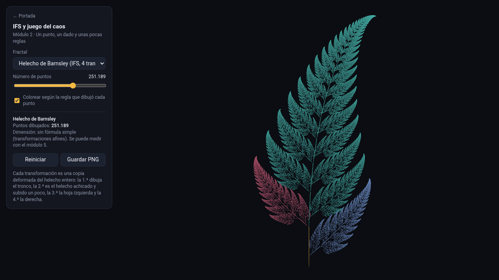

# Capítulo 3. Sistemas de funciones iteradas y juego del caos

::: resumen
**Resumen del capítulo.** Un IFS dibuja un fractal aplicando al azar transformaciones afines contractivas (juego del caos). Se ilustra con el triángulo de Sierpinski y el helecho de Barnsley.
:::

## 3.1 Descripción del algoritmo

Un **sistema de funciones iteradas (IFS)** es un conjunto finito de transformaciones afines contractivas `f1, …, fk`. Hutchinson (1981) demostró que existe un único conjunto compacto no vacío invariante bajo la unión de todas ellas, llamado **atractor**, y que es autosimilar. Barnsley y Demko (1985) desarrollaron este marco como método de construcción de fractales.

Cada transformación afín en el plano tiene la forma:

$$\begin{aligned} x' &= a\,x + b\,y + e \\ y' &= c\,x + d\,y + f \end{aligned}$$

### Juego del caos

El atractor se dibuja con un algoritmo probabilístico:

1. Elegir un punto inicial cualquiera.
2. Elegir al azar una transformación `fi`, con probabilidad `pi`.
3. Aplicar `fi` al punto y dibujar el resultado.
4. Repetir miles de veces, descartando los primeros puntos.

Los puntos se aproximan al atractor y lo recubren de forma progresiva.

### Ejemplos en la aplicación

- **Triángulo de Sierpinski.** Tres transformaciones que llevan el punto una fracción $r$ del camino hacia un vértice elegido al azar: $x' = r\,x + (1-r)\,v$. Con $r = 1/2$ la dimensión de similitud es $\ln 3 / \ln 2 \approx 1{,}585$.
- **Alfombra de Sierpinski.** Ocho transformaciones (las cuatro esquinas y los cuatro puntos medios de un cuadrado) con $r = 1/3$. Su dimensión es $\ln 8 / \ln 3 \approx 1{,}893$.
- **Helecho de Barnsley.** Cuatro transformaciones afines con probabilidades de 1 %, 85 %, 7 % y 7 %. La primera dibuja el tallo, la segunda es el helecho entero reducido y desplazado, y la tercera y la cuarta son las hojas izquierda y derecha.

Los controles son: el fractal, el número de puntos (de 1 000 a 5 millones), la razón de salto $r$ en los dos primeros ejemplos y una casilla que **colorea cada punto según la transformación que lo dibujó**. Esa casilla muestra que cada regla produce una copia reducida del todo. Se descartan los 20 primeros puntos y la imagen se acumula como una densidad en escala logarítmica.

**Qué pasa si se cambia $r$.** La fórmula $\ln n / \ln(1/r)$ solo vale mientras las copias no se solapan, es decir, mientras $r \le 1/2$ en el triángulo y $r \le 1/3$ en la alfombra. Con un $r$ mayor las copias se superponen, el dibujo se llena y la aplicación lo avisa. El helecho no tiene una fórmula tan simple: su dimensión se puede medir con el módulo 5.

## 3.2 Fortalezas

- **Descripción compacta.** Pocos coeficientes definen una forma muy compleja.
- **Implementación sencilla.** El bucle del juego del caos es corto y rápido.
- **Aspecto natural.** Permite modelar formas orgánicas como hojas y helechos.
- **Base matemática sólida.** La existencia y unicidad del atractor está demostrada (Hutchinson, 1981).

## 3.3 Debilidades

- **Convergencia estocástica.** Con pocos puntos la imagen es ruidosa; las zonas de baja probabilidad tardan en rellenarse.
- **Control indirecto.** Es difícil prever la forma resultante a partir de los coeficientes.
- **Resolución limitada.** La imagen depende del número de puntos y del tamaño del lienzo.
- **Problema inverso.** Hallar un IFS que reproduzca una forma dada es difícil.

## 3.4 Caso práctico de aplicación

Los IFS se han usado para **modelar vegetación y formas naturales** en gráficos por computadora y como base de algunos esquemas de **compresión fractal de imágenes**, que almacenan una imagen como las transformaciones que la regeneran. En la aplicación, el helecho de Barnsley sirve de ejemplo: siete números por transformación (seis coeficientes y una probabilidad) bastan para dibujar una hoja reconocible.

## 3.5 Capturas y demostración

{width=62% nota="Captura propia del módulo 2. Juego del caos con 3 vértices, r = 0,5 y 251 189 puntos."}

{width=62% nota="Captura propia. IFS de 4 transformaciones con 251 189 puntos."}

{width=62% nota="Captura propia. Cada color indica la transformación que dibujó el punto."}

<strong>Pruébalo en la aplicación.</strong> Escanea el código o abre la dirección: https://pieersx.github.io/geometria-fractal/modulos/02-ifs-chaos-game/

