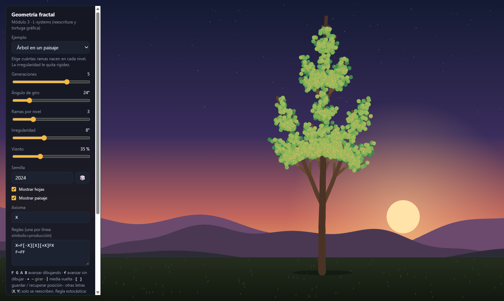
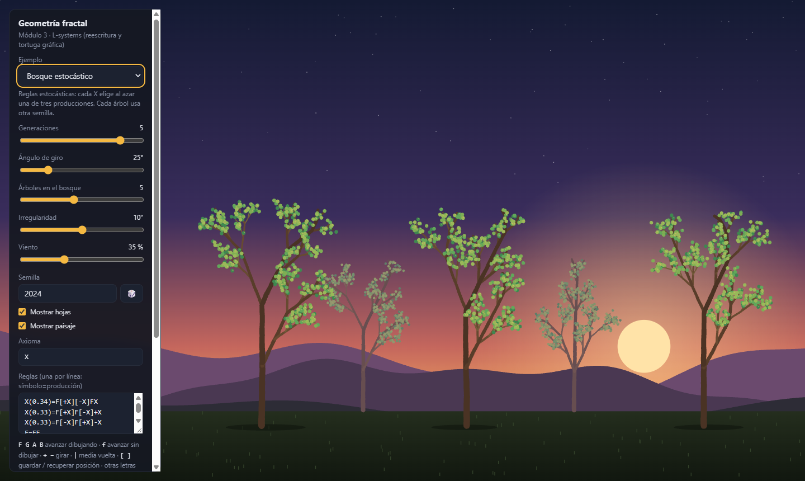
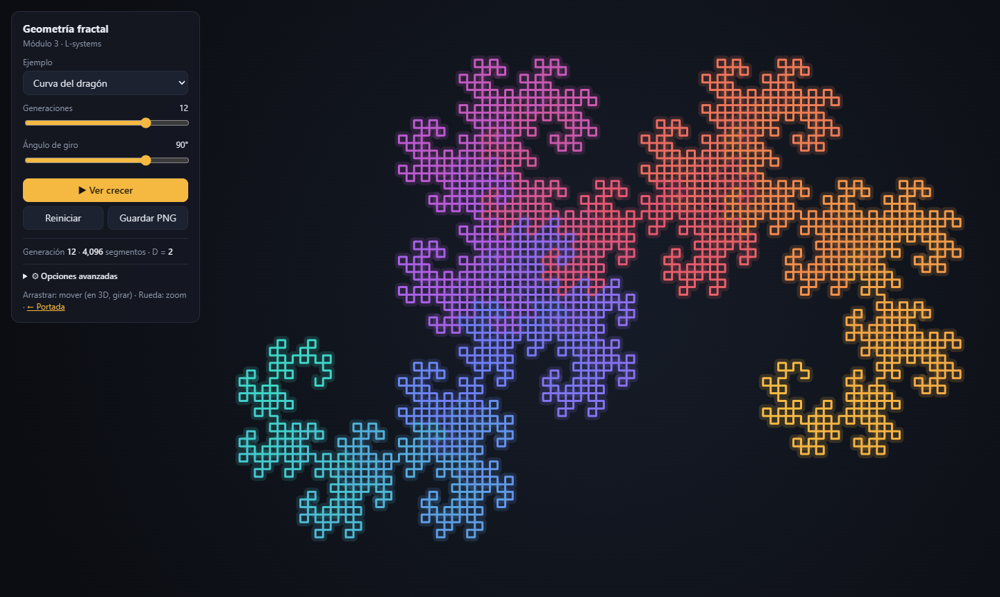
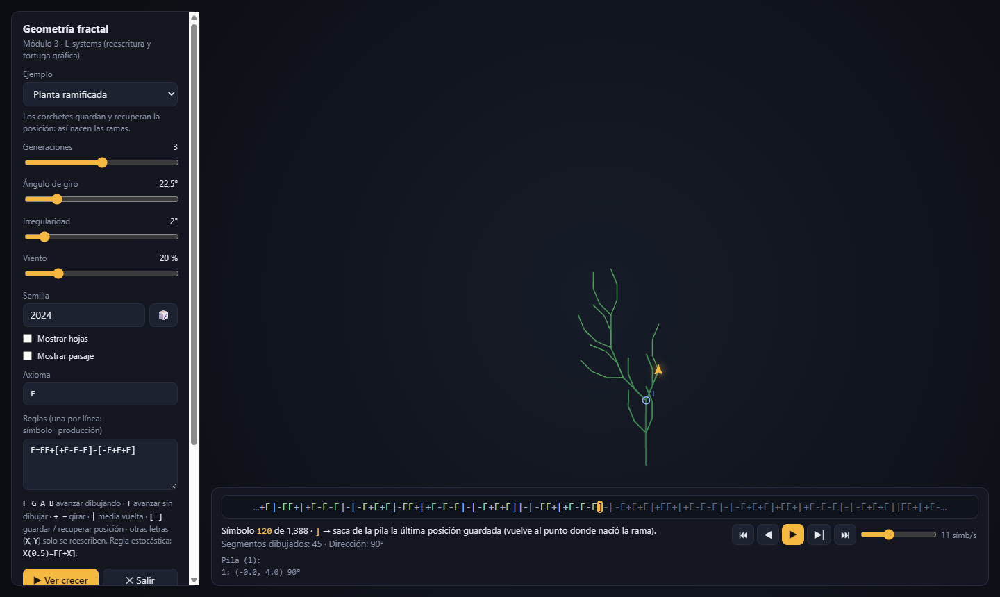
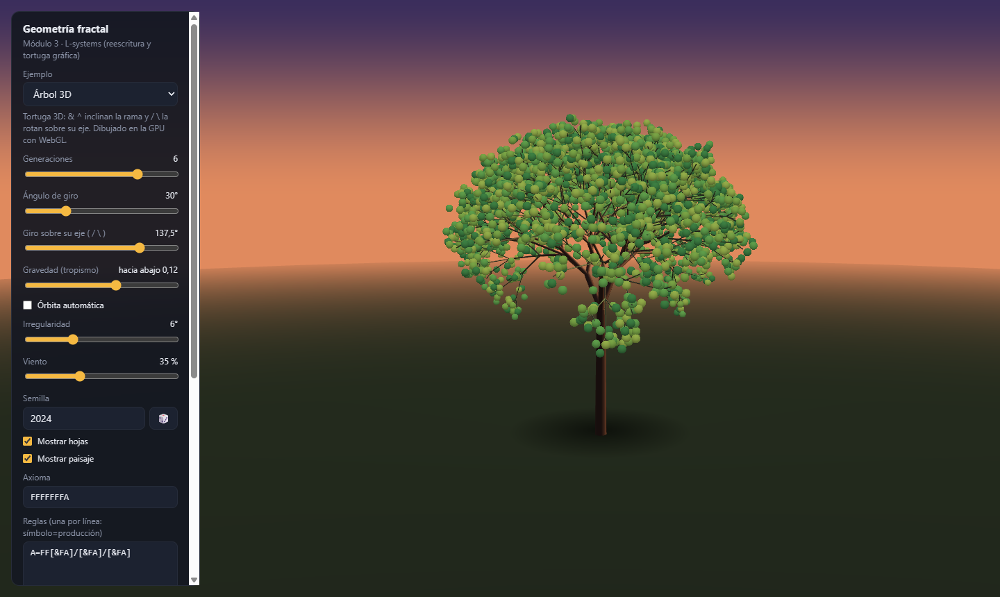
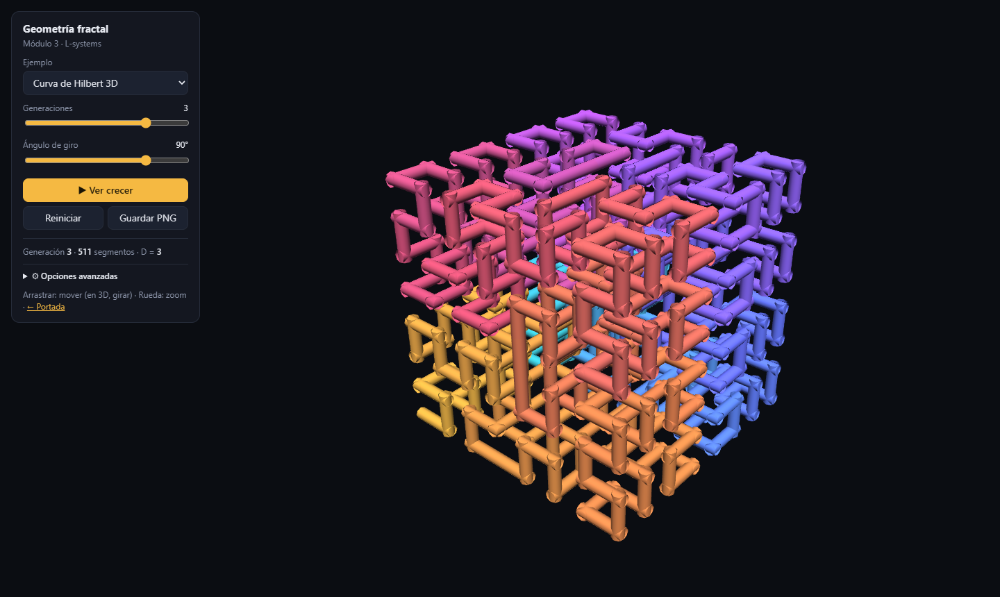

# Capítulo 4. L-systems

::: resumen
**Resumen del capítulo.** Un L-system reescribe cadenas de símbolos que una tortuga gráfica interpreta como dibujo. El módulo 3 lo aplica a curvas fractales (Koch, Sierpinski, dragón y Hilbert 3D) y a vegetación procedural en 2D y 3D, con reglas editables y estocásticas.
:::

## 4.1 Descripción del algoritmo

Un **L-system** (sistema de Lindenmayer) es un sistema de reescritura de cadenas. Lindenmayer (1968) lo propuso para describir el desarrollo de organismos filamentosos, donde todas las células se dividen en paralelo. Se compone de:

- Un **alfabeto** de símbolos.
- Un **axioma**, la cadena inicial.
- Un conjunto de **reglas de producción**, que reemplazan cada símbolo por una cadena.

En cada **generación**, las reglas se aplican a **todos** los símbolos a la vez (reescritura paralela). Los símbolos sin regla se copian igual. La cadena resultante se interpreta como instrucciones de dibujo para una **tortuga gráfica**, que tiene una posición y una dirección:

| Símbolo | Acción |
|---|---|
| `F`, `G`, `A`, `B` | Avanzar un paso dibujando una línea |
| `f` | Avanzar un paso sin dibujar |
| `+` / `−` | Girar a la izquierda / derecha el ángulo fijado |
| `\|` | Dar media vuelta |
| `[` | Guardar posición y dirección (apilar) |
| `]` | Recuperar posición y dirección (desapilar) |
| Otras letras (`X`, `Y`) | No dibujan; solo sirven para reescribirse |
| `&` / `^` | Solo en 3D: inclinar hacia abajo / hacia arriba |
| `\` / `/` | Solo en 3D: rotar sobre el propio eje |

: Símbolos del intérprete de tortuga

### Ejemplo de reescritura

Con axioma `F` y regla `F → F+F−−F+F` (curva de Koch):

- Generación 0: `F` (1 segmento)
- Generación 1: `F+F−−F+F` (4 segmentos)
- Generación 2: cada `F` vuelve a cambiarse por `F+F−−F+F` (16 segmentos)

Cada generación multiplica por 4 el número de segmentos y divide su largo entre 3. Por eso la dimensión de la curva límite es:

$$D = \frac{\ln 4}{\ln 3} \approx 1{,}262$$

### L-systems estocásticos

En un L-system **estocástico**, un símbolo puede tener varias producciones, cada una con un peso. Al reescribir, cada aparición del símbolo elige una producción al azar según esos pesos. Así, las mismas reglas producen plantas distintas de una misma «especie». Para que el resultado se pueda reproducir, el azar sale de un generador pseudoaleatorio con **semilla**.

### Tortuga en tres dimensiones

En 3D, la orientación de la tortuga se describe con tres vectores perpendiculares: **H** (hacia dónde avanza), **L** (su izquierda) y **U** (arriba). Cada giro es una rotación de dos de esos vectores alrededor del tercero: `+ −` giran alrededor de **U**, `& ^` alrededor de **L** y `\ /` alrededor de **H**. Así, una regla de texto puede describir ramas que salen en cualquier dirección del espacio.

El **tropismo** imita la acción de la gravedad o de la luz: antes de cada segmento de una rama, la dirección **H** se inclina un poco hacia un vector fijo **T**. En el módulo, **T** apunta hacia abajo, de modo que las ramas se curvan como si cedieran a su propio peso. Un valor negativo las curva hacia arriba.

### En la aplicación

El módulo 3 implementa el algoritmo en cuatro etapas:

1. **Lectura de reglas.** Cada línea tiene la forma `símbolo=producción`. Para una regla estocástica se agrega un peso entre paréntesis, por ejemplo `X(0.34)=F[+X][-X]FX`. Si un símbolo tiene varias reglas sin peso, todas tienen la misma probabilidad.
2. **Reescritura paralela** durante el número de generaciones elegido, con un límite de 1 500 000 símbolos para no bloquear el navegador.
3. **Compilación** de la cadena a una lista compacta de instrucciones de tortuga. En esta etapa se validan los corchetes y se limita el dibujo a 400 000 segmentos.
4. **Interpretación** de la tortuga y **dibujo en Canvas 2D**. Los segmentos se agrupan por color y grosor para trazarlos con pocas llamadas.

Ejemplos incluidos:

| Ejemplo | Axioma | Reglas | Ángulo | Dimensión teórica |
|---|---|---|---|---|
| Curva de Koch | `F` | `F → F+F−−F+F` | 60° | ln 4 / ln 3 ≈ 1,262 |
| Copo de nieve de Koch | `F−−F−−F` | `F → F+F−−F+F` | 60° | ln 4 / ln 3 ≈ 1,262 |
| Triángulo de Sierpinski | `A` | `A → B−A−B`, `B → A+B+A` | 60° | ln 3 / ln 2 ≈ 1,585 |
| Curva del dragón | `FX` | `X → X+YF+`, `Y → −FX−Y` | 90° | 2 (llena una región) |
| Planta ramificada | `F` | `F → FF+[+F−F−F]−[−F+F+F]` | 22,5° | — |
| Árbol en un paisaje | `X` | `X → F[−X][X][+X]FX`, `F → FF` | 24° | — |
| Bosque estocástico | `X` | tres reglas para `X` (pesos 0,34 / 0,33 / 0,33) y `F → FF` | 25° | — |
| Árbol 3D | `FFFFFFFA` | `A → FF[&FA]/[&FA]/[&FA]` | 30°, giro de 137,5° | — |
| Curva de Hilbert 3D | `A` | cuatro reglas para `A`, `B`, `C` y `D` | 90° | 3 (llena el cubo) |

: Ejemplos incluidos en el módulo 3

En el árbol, el control **Ramas por nivel** (de 2 a 6) genera automáticamente la regla de `X` con ese número de corchetes. La **irregularidad** desvía un poco cada giro y cada tramo, con valores pseudoaleatorios fijados por la semilla. El grosor de las ramas, las hojas, el **viento** y el paisaje al atardecer son añadidos gráficos: no forman parte del L-system ni simulan el crecimiento biológico real.

**Modo 3D.** Los dos últimos ejemplos se dibujan con **WebGL**, como los módulos 1 y 4. Cada segmento se convierte en un tubo de triángulos (7 u 8 caras) cuyo radio disminuye con el nivel de la rama; la GPU los ilumina con una luz direccional, luz ambiental de cielo y suelo, y niebla hacia el horizonte. Las hojas son puntos dibujados en la GPU y el viento se calcula en el *vertex shader*, sin volver a generar la geometría. En el árbol, el giro sobre el eje es de 137,5° (el ángulo áureo), con lo que las ramas sucesivas se reparten alrededor del tronco sin alinearse, de forma parecida a la disposición de las hojas en muchas plantas. La curva de Hilbert 3D usa cuatro símbolos de control (`A`, `B`, `C`, `D`) que no dibujan; en la generación *n* recorre los 8ⁿ puntos de una cuadrícula cúbica de lado 2ⁿ sin pasar dos veces por el mismo (se comprobó para *n* = 1, 2 y 3).

Además, la aplicación permite:

- **Editar** el axioma y las reglas y ver el resultado de inmediato, con avisos si hay corchetes sin cerrar o si el dibujo supera los límites.
- **Ver crecer** el dibujo, en 2D y en 3D: la tortuga traza los segmentos en el mismo orden en que lee la cadena.
- Seguir la lectura en el modo **paso a paso**: la cadena aparece con el símbolo actual resaltado, una explicación de lo que hace y el contenido de la pila, que también se marca sobre el dibujo.
- Consultar la **cadena de cada generación** y las estadísticas (símbolos, segmentos, hojas y dimensión teórica).
- Acercar y mover el dibujo (o girar la cámara en 3D) con el ratón, con gestos táctiles o con el teclado, y exportarlo a PNG.

## 4.2 Fortalezas

- **Descripción muy compacta.** Una o dos reglas producen estructuras ramificadas complejas.
- **Edición intuitiva.** Cambiar una regla, el axioma o el ángulo da formas nuevas, como el paso de la curva de Koch al copo de nieve con solo cambiar el axioma.
- **Adecuado para plantas.** La pila `[` `]` modela de manera natural la ramificación.
- **Extensible.** Admite variantes con probabilidades (implementadas en el módulo), parámetros o influencia del entorno.
- **Reproducible.** Con la semilla, un mismo bosque estocástico se puede regenerar exactamente.
- **Pasa de 2D a 3D sin cambiar el algoritmo.** Basta agregar símbolos de rotación a la tortuga; la reescritura es la misma.

## 4.3 Debilidades

- **Crecimiento exponencial.** La longitud de la cadena crece con cada generación. En el módulo, la planta pasa de 4 096 segmentos en la generación 4 a 32 768 en la 5, por lo que cada ejemplo limita el número de generaciones.
- **Aspecto rígido.** Las versiones determinísticas producen plantas demasiado regulares. El módulo lo atenúa con irregularidad y reglas estocásticas, pero el resultado sigue siendo esquemático.
- **Poco control geométrico fino.** Ajustar una forma concreta requiere ensayo y error.
- **Reglas sin garantía.** Una regla arbitraria no asegura un resultado reconocible.
- **Solo describe la estructura.** El grosor, las hojas y el color deben añadirse por separado.
- **Uniones visibles en 3D.** Al representar cada segmento como un tubo independiente, los quiebres bruscos (como los ángulos rectos de la curva de Hilbert) se ven como piezas superpuestas y no como una superficie continua.

## 4.4 Caso práctico de aplicación

Los L-systems se usan para **generar vegetación procedural** en videojuegos, cine y simulaciones, donde interesa producir muchas plantas distintas a partir de reglas breves. El ejemplo **Bosque estocástico** lo muestra: con tres reglas para `X` y una semilla distinta por árbol se obtiene un bosque variado, y una misma semilla reproduce siempre el mismo bosque. Los ejemplos geométricos (Koch, Sierpinski y dragón) permiten comparar un fractal de contorno con otro de ramificación. El triángulo de Sierpinski, además, conecta con el módulo 2: dos métodos distintos, la reescritura de cadenas y los IFS, llegan al mismo conjunto límite.

## 4.5 Capturas y demostración

{width=62% nota="Captura propia del módulo 3. Axioma `X`, regla `X → F[−X][X][+X]FX`, `F → FF`; 5 generaciones, 24°, irregularidad 8°."}

{width=62% nota="Captura propia. Tres reglas para `X` con pesos 0,34 / 0,33 / 0,33; semilla 2024 y 5 árboles. Cada árbol usa otra semilla derivada."}

{width=62% nota="Captura propia. 12 generaciones (4 096 segmentos). El color sigue el orden en que la tortuga recorre la curva."}

{width=62% nota="Captura propia. Planta de 3 generaciones en el símbolo 120: la cadena resalta el símbolo leído y los círculos azules marcan las posiciones guardadas en la pila."}

{width=62% nota="Captura propia. Tortuga 3D con giro sobre el eje de 137,5°, tropismo 0,12 y 6 generaciones (1 827 segmentos), dibujado con WebGL."}

{width=62% nota="Captura propia. Generación 3: una sola curva de 511 segmentos que visita los 512 puntos de un cubo de 8 × 8 × 8."}

<strong>Pruébalo en la aplicación.</strong> Escanea el código o abre la dirección: https://pieersx.github.io/geometria-fractal/modulos/03-l-systems/

