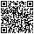

# Capítulo 4. L-systems

::: resumen
**Resumen del capítulo.** Un L-system reescribe cadenas de símbolos que una tortuga gráfica interpreta como dibujo. Sirve para la curva de Koch y para plantas ramificadas.
:::

> **Estado:** borrador. El módulo 3 está pendiente; el texto describe lo que se planea implementar. **Su responsable debe ajustarlo al terminar.**

## 4.1 Descripción del algoritmo

Un **L-system** (sistema de Lindenmayer) es un sistema de reescritura de cadenas. Lindenmayer (1968) lo propuso para describir el desarrollo de organismos filamentosos, donde todas las células se dividen en paralelo. Se compone de:

- Un **alfabeto** de símbolos.
- Un **axioma**, la cadena inicial.
- Un conjunto de **reglas de producción**, que reemplazan cada símbolo por una cadena.

En cada generación, las reglas se aplican a **todos** los símbolos a la vez. La cadena resultante se interpreta como instrucciones de dibujo, al estilo de una tortuga gráfica:

| Símbolo | Acción |
|---|---|
| `F` | Avanzar dibujando una línea |
| `+` / `−` | Girar a la izquierda / derecha un ángulo fijo |
| `[` | Guardar posición y orientación (apilar) |
| `]` | Recuperar posición y orientación (desapilar) |

: Símbolos del intérprete de tortuga

### Ejemplos que se implementarán

- **Curva de Koch.** Axioma `F`, regla `F → F+F−−F+F`, ángulo 60°. Dimensión $\ln 4 / \ln 3 \approx 1{,}262$.
- **Planta con ramificación.** Axioma `F`, regla `F → FF+[+F−F−F]−[−F+F+F]`, ángulo cercano a 22,5°. Los corchetes generan las ramas.

La aplicación permitirá **editar las reglas**, el ángulo y el número de generaciones, y mostrará el resultado de inmediato.

## 4.2 Fortalezas

- **Descripción muy compacta.** Una o dos reglas producen estructuras ramificadas complejas.
- **Edición intuitiva.** Cambiar una regla o un ángulo da formas nuevas.
- **Adecuado para plantas.** La pila `[` `]` modela de manera natural la ramificación.
- **Extensible.** Admite variantes con probabilidades, parámetros o entorno.

## 4.3 Debilidades

- **Crecimiento exponencial.** La longitud de la cadena crece con cada generación, lo que limita el número de iteraciones que el navegador puede dibujar.
- **Aspecto rígido.** Las versiones determinísticas producen plantas demasiado regulares si no se introduce aleatoriedad.
- **Poco control geométrico fino.** Ajustar una forma concreta requiere ensayo y error.
- **Reglas sin garantía.** Una regla arbitraria no asegura un resultado reconocible.

## 4.4 Caso práctico de aplicación

Los L-systems se usan para **generar vegetación procedural** en videojuegos, cine y simulaciones, donde interesa producir muchas plantas distintas a partir de reglas breves. En la aplicación, partir de la curva de Koch y de la planta de ejemplo permite comparar un fractal de contorno con otro de ramificación.

## 4.5 Capturas y demostración

- Captura: **[pendiente — módulo 3]**

<strong>Pruébalo en la aplicación.</strong> Escanea el código o abre la dirección: https://pieersx.github.io/geometria-fractal/modulos/03-l-systems/

