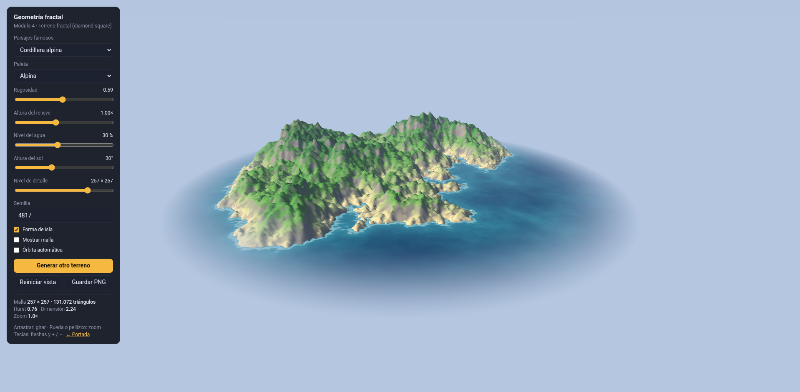
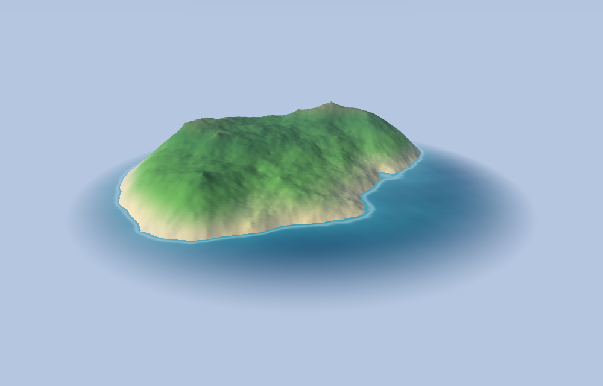
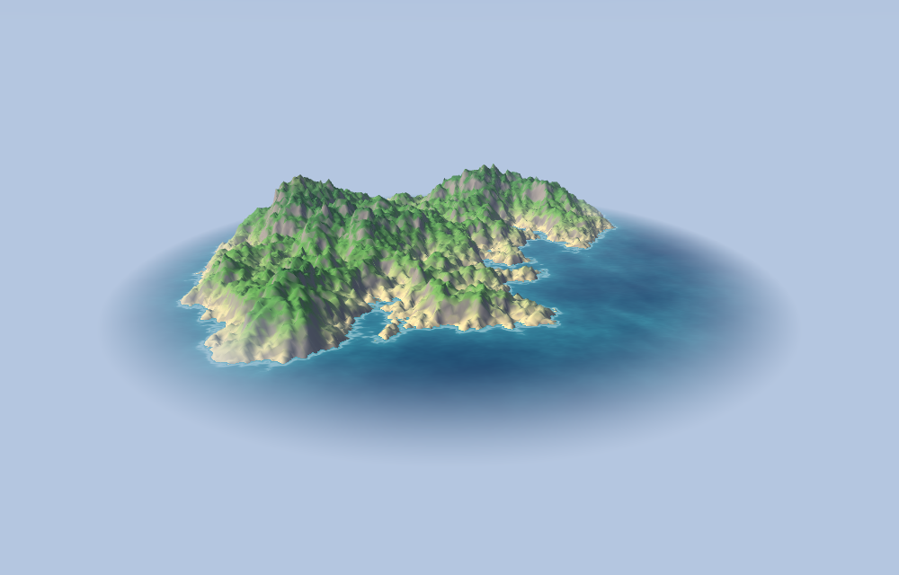
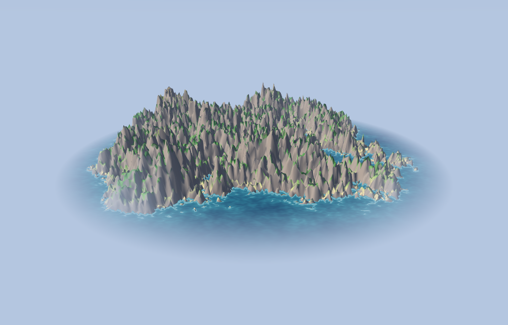
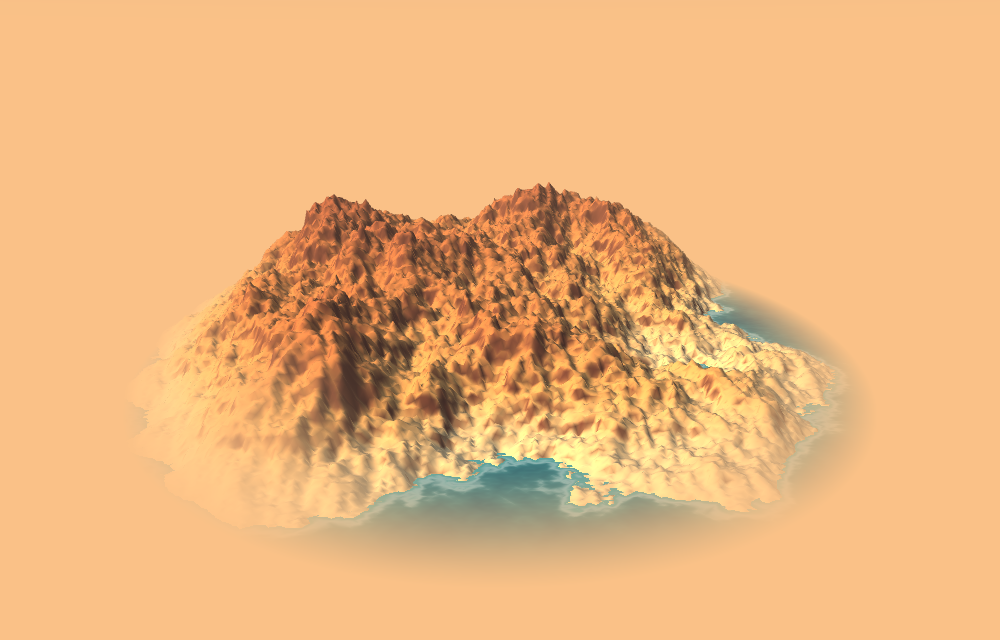
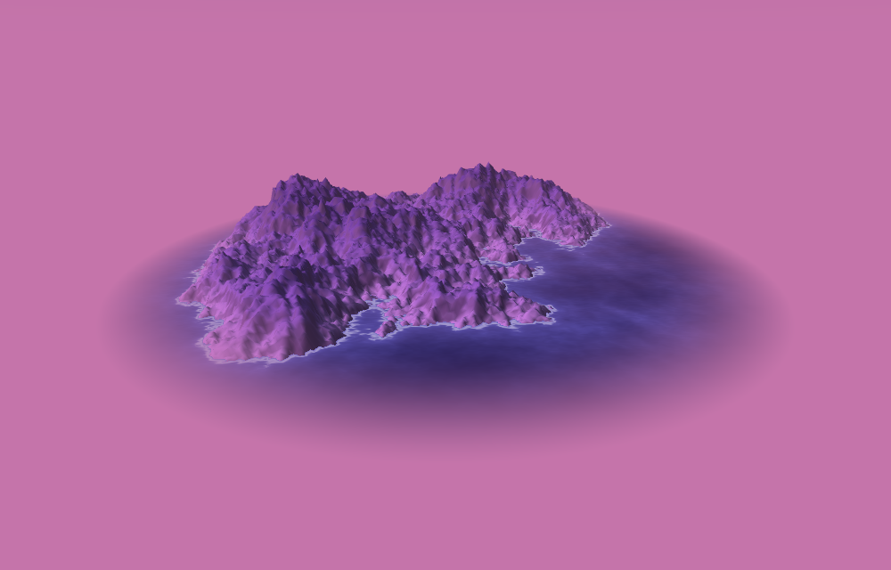
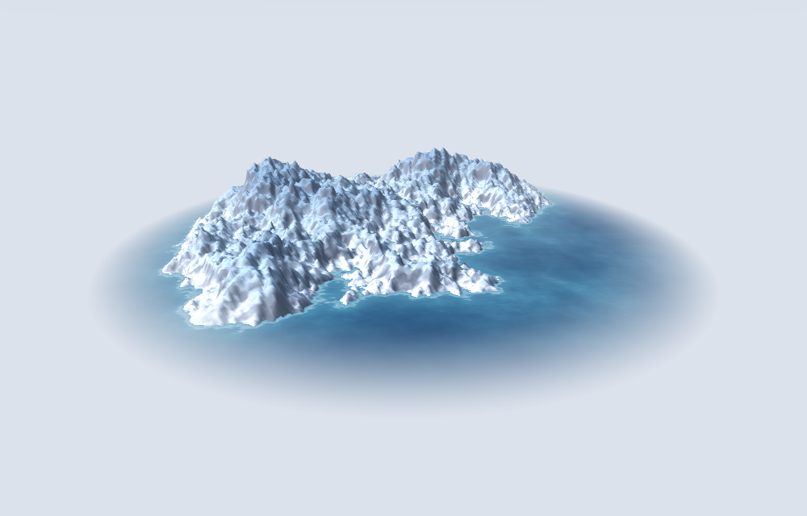
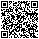

# Capítulo 5. Terreno fractal (diamond-square)

::: resumen
**Resumen del capítulo.** El módulo 4 genera terrenos con diamond-square y los dibuja en WebGL. La rugosidad $r$ controla el relieve y se relaciona con el exponente de Hurst $H$ y con la dimensión $D$.
:::

## 5.1 Descripción del algoritmo

Un terreno natural presenta relieve a muchas escalas: cordilleras, colinas, rocas. Un **terreno fractal** reproduce esa propiedad combinando variaciones de altura en distintas escalas. Existen dos familias principales:

### Movimiento browniano fraccionario (fBm)

Se suman varias capas (octavas) de ruido suave. En cada octava la **frecuencia** se multiplica por un factor (la lacunaridad, normalmente 2) y la **amplitud** se reduce por otro factor (la persistencia, normalmente 0,5). El ruido de base suele ser un ruido de gradiente como el propuesto por Perlin (1985). La **rugosidad** del terreno se controla con el exponente de Hurst *H*, entre 0 y 1: valores bajos dan relieve áspero y valores altos, relieve suave. La dimensión fractal de la superficie resultante es aproximadamente:

$$D = 3 - H$$

### Subdivisión con desplazamiento del punto medio (diamond-square)

Parte de una cuadrícula cuadrada con las cuatro esquinas fijadas y repite dos pasos: asignar al centro de cada cuadrado el promedio de sus esquinas más un desplazamiento aleatorio (paso *diamond*), y asignar a los puntos medios de los bordes el promedio de sus vecinos más otro desplazamiento (paso *square*). La amplitud del desplazamiento se reduce en cada ronda. Este enfoque de subdivisión estocástica corresponde a la línea de trabajo de Fournier et al. (1982).

### En la aplicación

El módulo implementa **diamond-square** sobre una cuadrícula de lado 2ⁿ+1, con n entre 5 y 9 (de 33 × 33 a 513 × 513 puntos, es decir, hasta 524 288 triángulos). Las cuatro esquinas parten de valores aleatorios pequeños y la amplitud inicial del desplazamiento es 1. Al terminar cada ronda, la amplitud se multiplica por la **rugosidad** *r* (entre 0,30 y 0,90; 0,59 por defecto). En los bordes, los puntos del paso *square* promedian solo los vecinos que existen, sin envolver la malla.

Multiplicar la amplitud por *r* en cada ronda equivale a un exponente de Hurst (derivación propia a partir de la relación entre ambos parámetros):

$$H = -\log_2 r$$

Con *r* = 0,59, $H \approx 0{,}76$ y $D \approx 2{,}24$. Cuando $r < 0{,}5$ resulta $H > 1$ y la superficie es lisa, por lo que el panel muestra *D* = 2. El módulo presenta estos valores como **estimación teórica** de la superficie generada; no mide la dimensión fractal del resultado.

Los desplazamientos salen de un generador pseudoaleatorio con **semilla** (0 a 4 294 967 295), así que una misma semilla reproduce el mismo terreno. Después de generar, las alturas se normalizan al rango 0–1, se elevan a la potencia 1,4 para marcar los picos y, si está activa la opción «Forma de isla», se atenúan hacia los bordes del mapa. Estos dos últimos pasos modifican la forma global, no la rugosidad local.

La visualización usa **WebGL**. La altura de cada punto y su pendiente se envían a la GPU como una malla triangular; un *fragment shader* calcula el color final:

- **Elevación y pendiente:** seis colores por altura (orilla, pasto, bosque, altiplano, roca y nieve), con roca en las laderas empinadas y nieve en las cumbres planas.
- **Agua:** una superficie al nivel del mar, con color según la profundidad, oleaje, reflejo del cielo (efecto Fresnel) y espuma en la orilla.
- **Luz y atmósfera:** iluminación difusa con un sol de altura regulable, cielo en degradado y niebla que difumina el horizonte.

Controles disponibles: paisajes predefinidos, paleta (alpina, desierto, violeta, ártico), rugosidad, altura del relieve (reescala sin regenerar), nivel del agua, altura del sol, nivel de detalle, semilla, forma de isla, malla visible, órbita automática, giro con ratón, pellizco o flechas, zoom con rueda o teclas + y −, reinicio de vista y guardado en PNG. El panel muestra el tamaño de la malla, *H*, *D*, el zoom y los cuadros por segundo.

## 5.2 Fortalezas

- **Aspecto natural convincente** con pocos parámetros.
- **Control de la rugosidad** mediante un único parámetro (*H* o la persistencia).
- **Eficiencia.** El diamond-square calcula una malla de lado 2ⁿ+1 en tiempo lineal respecto al número de puntos; el fBm se evalúa por punto y se puede paralelizar.
- **Reproducibilidad** al fijar la semilla del generador aleatorio.
- **Interactividad.** El dibujo corre en la GPU. En una prueba con un navegador automatizado, la malla máxima (513 × 513) se redibujó a cerca de 60 cuadros por segundo; no se midió en otros equipos.

## 5.3 Debilidades

- **Falta de realismo geológico.** No modelan erosión ni procesos físicos, por lo que los terrenos resultan homogéneos.
- **Artefactos.** El diamond-square puede dejar marcas en forma de cuadrícula; el fBm con ruido de gradiente puede mostrar direcciones preferentes.
- **Restricciones de tamaño.** El diamond-square exige mallas de lado 2ⁿ+1.
- **Control local limitado.** Es difícil colocar a propósito un valle o una cima concretos.
- **Iluminación local.** La aplicación calcula luz difusa por punto, sin sombras proyectadas ni erosión, y limita la malla a 513 × 513 puntos.

## 5.4 Caso práctico de aplicación

Los terrenos fractales son habituales en **videojuegos, simulación y cine** para generar paisajes sin modelarlos a mano. El ruido de gradiente de Perlin (1985) nació precisamente como herramienta de síntesis de texturas en imágenes por computadora. En la aplicación, bajar la rugosidad produce llanuras suaves y subirla produce cordilleras abruptas.

## 5.5 Capturas y demostración

{width=90% nota="Captura propia. Semilla 4817, rugosidad 0,59, malla de 257 × 257. El panel muestra *H* ≈ 0,76 y *D* ≈ 2,24."}

{width=78% nota="Captura propia. Semilla 4817, *r* = 0,40. Superficie lisa: *D* = 2."}

{width=78% nota="Captura propia. Semilla 4817, *r* = 0,59. *H* ≈ 0,76 y *D* ≈ 2,24."}

{width=78% nota="Captura propia. Semilla 4817, *r* = 0,80. *H* ≈ 0,32 y *D* ≈ 2,68. A mayor rugosidad, relieve más áspero."}

{width=78% nota="Captura propia. Semilla 4817, *r* = 0,59, agua al 10 %. La paleta cambia el color, no la forma."}

{width=78% nota="Captura propia. Semilla 4817, *r* = 0,59."}

{width=78% nota="Captura propia. Semilla 4817, *r* = 0,59."}

<strong>Pruébalo en la aplicación.</strong> Escanea el código o abre la dirección: https://pieersx.github.io/geometria-fractal/modulos/04-terreno-fractal/

