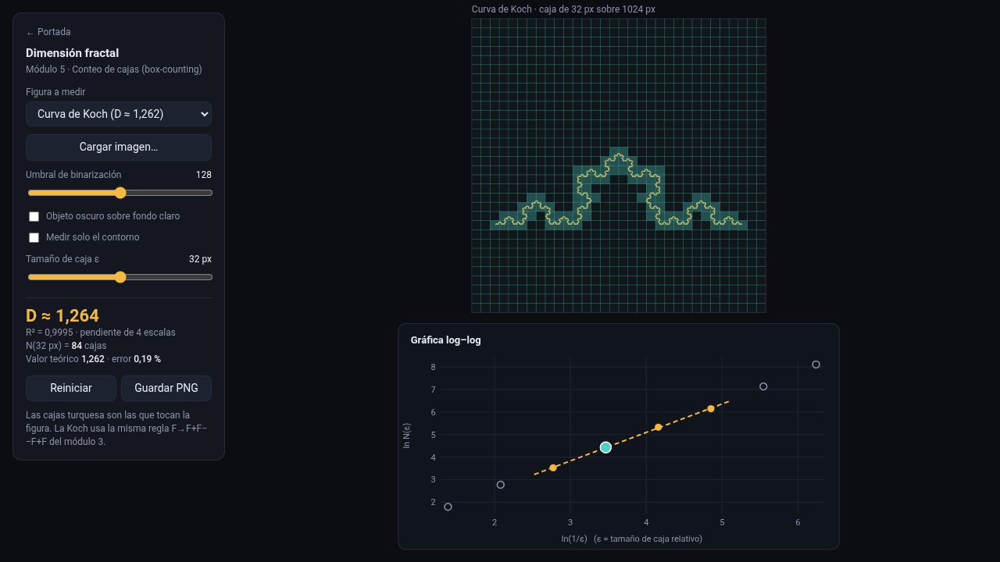
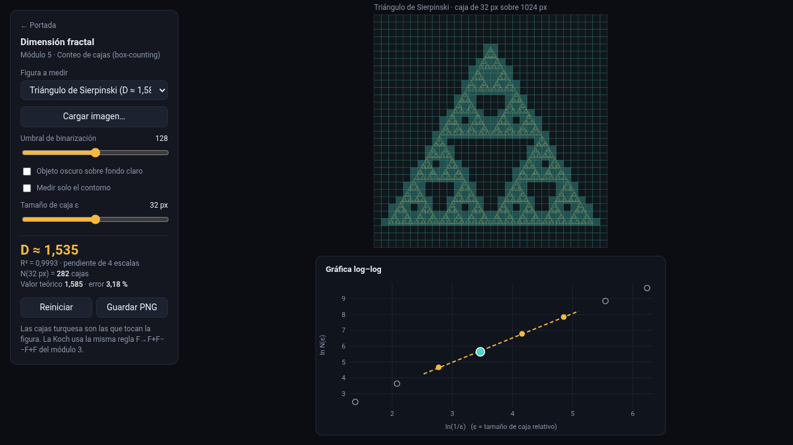
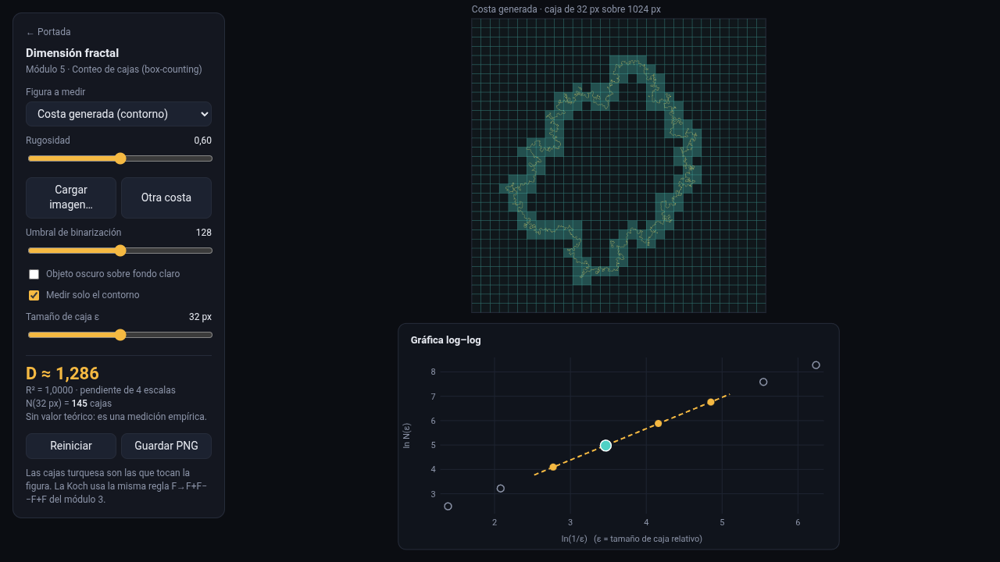
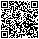

# Capítulo 6. Dimensión fractal y box-counting

::: resumen
**Resumen del capítulo.** El conteo de cajas estima la dimensión fractal de una imagen a partir de la pendiente de $\log N(\varepsilon)$ frente a $\log(1/\varepsilon)$. Se valida con la curva de Koch y el triángulo de Sierpinski.
:::

## 6.1 Descripción del algoritmo

La **dimensión fractal** cuantifica cuánto espacio ocupa una forma a distintas escalas. Mandelbrot (1967) usó esta idea para describir la rugosidad de las costas: cuanto más irregular es el contorno, mayor es su dimensión, entre 1 (una curva suave) y 2 (una curva que llena el plano).

El método de **conteo de cajas** (*box-counting*) la estima de forma empírica:

1. Convertir la imagen a blanco y negro (binarizar), de modo que la forma de interés quede como píxeles activos.
2. Cubrir la imagen con una malla de cajas cuadradas de lado ε.
3. Contar el número *N(ε)* de cajas que contienen al menos un píxel activo.
4. Repetir con varios valores de ε (por ejemplo, potencias de 2).
5. Representar $\log N(\varepsilon)$ frente a $\log(1/\varepsilon)$. La **pendiente** de la recta de mejor ajuste estima la dimensión:

$$N(\varepsilon) \propto \varepsilon^{-D} \quad\Longrightarrow\quad D \approx \text{pendiente de } \log N(\varepsilon) \text{ frente a } \log (1/\varepsilon)$$

Liebovitch y Toth (1989) describen un algoritmo rápido para este cálculo, que sirve de referencia para la implementación.

### En la aplicación

La aplicación trabaja con una imagen de 1 024 × 1 024 píxeles. Puede **generar** una figura de prueba (línea, cuadrado, curva de Koch, triángulo de Sierpinski o una costa) o **cargar una imagen propia**. En una imagen propia el umbral de binarización se calcula con el método de Otsu y se puede mover; una casilla indica si el objeto es oscuro sobre fondo claro y otra permite medir solo el contorno.

Para cada tamaño de caja $s = 2^k$ píxeles se cuentan las cajas que tocan la figura. La aplicación dibuja esas cajas sobre la figura, muestra la gráfica log-log con la recta de ajuste y escribe el valor de *D*, el coeficiente $R^2$ y, en las figuras de prueba, el error respecto a la teoría. El ajuste usa solo $s = 8 \ldots 64$ px: con cajas menores se mide el grosor del trazo, y con cajas mayores la figura cabe en pocas cajas.

La curva de Koch se dibuja con la misma regla `F → F+F−−F+F` que usa el módulo 3. El módulo 5 incluye su propia copia de esa regla, no la importa del módulo 3, de modo que ambos módulos comparten la regla pero no el código.

### Ejemplo con números

Con la curva de Koch de la aplicación (imagen de 1 024 px) se obtienen estos conteos:

| Lado de la caja *s* (px) | Cajas ocupadas *N(s)* | $\ln(1024/s)$ | $\ln N(s)$ |
|---|---|---|---|
| 8 | 468 | 4,852 | 6,148 |
| 16 | 206 | 4,159 | 5,328 |
| 32 | 84 | 3,466 | 4,431 |
| 64 | 34 | 2,773 | 3,526 |

: Conteo de cajas de la curva de Koch

Al duplicar el lado de la caja, el número de cajas se divide aproximadamente entre $2^{D}$: de 468 a 206 baja 2,27 veces, de 206 a 84, 2,45 veces, y de 84 a 34, 2,47 veces. Con $D = 1{,}262$ se esperaría un factor $2^{1{,}262} \approx 2{,}40$. El ajuste por mínimos cuadrados de $\ln N$ frente a $\ln(1024/s)$ da una pendiente de **1,264**, con $R^2 = 0{,}9995$, muy cerca del valor teórico $\ln 4 / \ln 3 \approx 1{,}262$. Si se usaran solo las dos cajas más pequeñas, la pendiente sería 1,18, y con las dos más grandes, 1,30; por eso conviene ajustar sobre varias escalas y declararlas.

### Validación

Se midieron figuras de dimensión conocida (escalas de 8 a 64 px, imagen de 1 024 px):

| Figura | *D* teórica | *D* medida | Error |
|---|---|---|---|
| Línea recta | 1,000 | 0,988 | 1,2 % |
| Curva de Koch | 1,262 | 1,264 | 0,2 % |
| Triángulo de Sierpinski | 1,585 | 1,535 | 3,2 % |
| Cuadrado relleno | 2,000 | 1,936 | 3,2 % |

El coeficiente $R^2$ fue mayor que 0,999 en todos los casos. El error mayor, de 3,2 %, aparece en el triángulo y en el cuadrado. Se debe a que en las cajas grandes la figura ocupa pocas cajas y a que el resultado depende de la posición de la malla.

### Costa generada

La costa se construye por desplazamiento del punto medio; el control de rugosidad es el exponente *H*, que fija cuánto decae el desplazamiento en cada nivel (*H* alto da una costa más suave). Midiendo solo el contorno con la semilla 7 se obtuvo *D* ≈ 1,50 con *H* = 0,3, ≈ 1,29 con 0,6 y ≈ 1,11 con 0,9: una costa más irregular tiene mayor dimensión, como describe Mandelbrot (1967). Este valor es una medición empírica, no tiene un teórico con el que compararlo.

## 6.2 Fortalezas

- **Aplicable a imágenes reales,** no solo a fractales matemáticos.
- **Simple de implementar** y de explicar.
- **Resultado numérico interpretable,** acompañado de una gráfica que permite juzgar la calidad del ajuste.

## 6.3 Debilidades

- **Sensible a la binarización.** El umbral elegido cambia la forma analizada y, con ella, el resultado.
- **Rango de escalas finito.** La imagen tiene resolución limitada, por lo que el comportamiento de ley de potencias solo se cumple en un intervalo.
- **Dependencia de la posición de la malla** y de la elección de tamaños de caja.
- **Un objeto natural no es autosimilar infinitamente,** así que el valor es una estimación y no una propiedad exacta.

## 6.4 Caso práctico de aplicación

La dimensión fractal se emplea para **caracterizar formas naturales**: líneas de costa, redes de ramificación, texturas de tejidos o de superficies. El caso clásico es la medición de costas (Mandelbrot, 1967). En la aplicación se puede cargar, por ejemplo, la silueta de un mapa o de una hoja, medir solo su contorno y comparar su dimensión con la de una figura geométrica simple.

## 6.5 Capturas y demostración

{width=62% nota="Captura propia del módulo 5. Caja de 32 px; D = 1,264 frente al valor teórico 1,262 (error 0,19 %), con R² = 0,9995."}

{width=62% nota="Captura propia. Las cajas turquesa son las que tocan la figura; los puntos naranja son los usados en el ajuste."}

{width=62% nota="Captura propia. Contorno de una isla por desplazamiento del punto medio, con rugosidad 0,6."}

<strong>Pruébalo en la aplicación.</strong> Escanea el código o abre la dirección: <a href="https://pieersx.github.io/geometria-fractal/modulos/05-dimension-fractal/">https://pieersx.github.io/geometria-fractal/modulos/05-dimension-fractal/</a>

